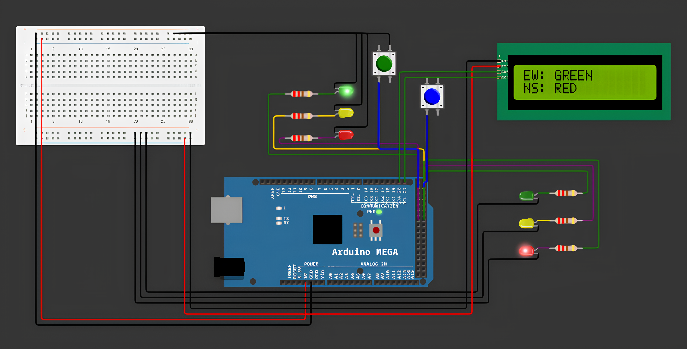

# Smart Traffic Light FSM Control

<table align="center">
  <tr>
    <td align="center">
      
    </td>
  </tr>
</table>

## Overview

Smart Traffic Light FSM Control is an embedded application for Arduino Mega that controls a
two-direction intersection (**East–West** and **North–South**) using Finite State Machines (FSM)
and the FreeRTOS real-time operating system. East–West has priority and stays green until a
North–South request is generated by a push button. The system then runs a safe
**GREEN → YELLOW → RED** sequence, serves North–South, and returns to East–West. The current state
of both directions is reported in real time on an LCD and over Serial.

## Features

- **Finite State Machines**: One independent FSM per direction, with the states `TRAFFIC_RED`,
  `TRAFFIC_YELLOW` and `TRAFFIC_GREEN`. Every transition is validated, so an invalid change is
  rejected and reported.
- **Request-Based Control**: East–West stays green by default, and a press on the North button
  triggers the North–South cycle. A short all-red interval guarantees that both directions are
  never green at the same time.
- **FreeRTOS Multitasking**: Separate tasks for the North button, the night-mode button and the
  intersection controller, synchronized through binary semaphores and timed with `vTaskDelay()`
  and `vTaskDelayUntil()`.
- **Button Debouncing**: Software debounce (50 ms) so each physical press generates exactly one
  event.
- **Night Mode**: A second button toggles flashing yellow on both directions, and normal
  requests are ignored while it is active.
- **Real-Time Display**: Shows both states and the active request on a 16x2 I2C LCD and prints
  every transition on the Serial Monitor.

## Technologies

- **Platform**: Arduino Mega
- **Language**: C++ (Arduino Framework)
- **RTOS**: FreeRTOS
- **Libraries**: LiquidCrystal_I2C
- **Build System**: PlatformIO
- **Simulation**: Wokwi
- **Development Tools**: Visual Studio Code + PlatformIO IDE
- **Version Control**: Git, GitHub

## Project Structure

```
src/
├── button/
│   ├── button.cpp
│   └── button.h
├── fsm/
│   ├── fsm.cpp
│   └── fsm.h
├── lcd_display/
│   ├── lcd_display.cpp
│   └── lcd_display.h
├── led/
│   ├── led.cpp
│   └── led.h
├── night_mode/
│   ├── night_mode.cpp
│   └── night_mode.h
├── serial_comm/
│   ├── serial_comm.cpp
│   └── serial_comm.h
└── main.cpp
diagram.json
wokwi.toml
platformio.ini
```

## State Machine

Each direction has its own FSM instance:

```
        GREEN ───────► YELLOW ───────► RED
          ▲                              │
          └──────────────────────────────┘
```

| Current state | Allowed next states |
|---|---|
| `TRAFFIC_RED` | `TRAFFIC_GREEN`, `TRAFFIC_YELLOW` |
| `TRAFFIC_GREEN` | `TRAFFIC_YELLOW`, `TRAFFIC_RED` |
| `TRAFFIC_YELLOW` | `TRAFFIC_RED` |

At startup East–West is GREEN and North–South is RED.

### North–South Cycle

When a North request is received, the controller runs this sequence:

| Step | East–West | North–South | Duration |
|---|---|---|---|
| 1 | YELLOW | RED | 2 s |
| 2 | RED | RED | 0.5 s |
| 3 | RED | GREEN | 5 s |
| 4 | RED | YELLOW | 2 s |
| 5 | RED | RED | 0.5 s |
| 6 | GREEN | RED | until the next request |

## FreeRTOS Architecture

| Task | Priority | Role |
|---|---|---|
| `BtnNord` | 2 | Reads the North button with debounce and gives `northRequestSemaphore` |
| `BtnNight` | 2 | Reads the night-mode button with debounce and gives `nightSemaphore` |
| `Traffic` | 1 | Runs the two FSMs, the timings, the LCD and the Serial output |

The tick of this FreeRTOS port is about 16 ms, so every delay is converted with `pdMS_TO_TICKS()`
and the short polling periods of the button tasks use 1 tick.

## Night Mode

A press on the night button toggles the mode:

- **ON**: All red and green LEDs turn off and both yellow LEDs flash every 500 ms. North requests
  are ignored. The LCD shows the night-mode message.
- **OFF**: The intersection is reinitialized with East–West GREEN and North–South RED.

The mode can be activated at any moment, even during a North–South cycle.

## Pin Mapping

| Component | Pin | Action |
|---|---|---|
| East–West RED LED | 30 | East–West red light |
| East–West YELLOW LED | 31 | East–West yellow light |
| East–West GREEN LED | 32 | East–West green light |
| North–South RED LED | 33 | North–South red light |
| North–South YELLOW LED | 34 | North–South yellow light |
| North–South GREEN LED | 35 | North–South green light |
| North button | 22 | North–South request (`INPUT_PULLUP`, active LOW) |
| Night-mode button | 23 | Toggle night mode (`INPUT_PULLUP`, active LOW) |
| LCD (I2C, 0x27) | SDA 20 / SCL 21 | Displays the current states |

Every LED uses a 220 Ω series resistor.

## Resources

- [FreeRTOS Documentation](https://www.freertos.org/)
- [feilipu FreeRTOS Library](https://github.com/feilipu/Arduino_FreeRTOS_Library)
- [Wokwi Documentation](https://docs.wokwi.com/)
- [PlatformIO Documentation](https://docs.platformio.org/)
- [LiquidCrystal_I2C Library](https://github.com/johnrickman/LiquidCrystal_I2C)

## Installation

To build and run the application, follow these steps:

1. **Clone this repository:**
```bash
git clone https://github.com/Constantin-Stamate/traffic-light-fsm-control
```

2. **Navigate to the project directory:**
```bash
cd traffic-light-fsm-control
```

3. **Open the project in VS Code with the PlatformIO extension installed**

4. **Build the project:**
```bash
pio run
```

5. **Run the Wokwi simulation** (restart it after every build, so it loads the new firmware), or
upload to the board:
```bash
pio run --target upload
```

6. **Interact with the system:**
```
North button press -> North-South cycle (East-West YELLOW, RED, North-South GREEN, ...)
Night button press -> flashing yellow on both directions
Night button press again -> normal mode
```

7. **Observe the result:** the LEDs follow the FSM states, while the LCD and the Serial Monitor
display the current state after every transition.

## Contributors

**Smart Traffic Light FSM Control** was developed as part of the Internet of Things laboratory
works.

- GitHub: [Constantin-Stamate](https://github.com/Constantin-Stamate)
- Email: constantinstamate.r@gmail.com